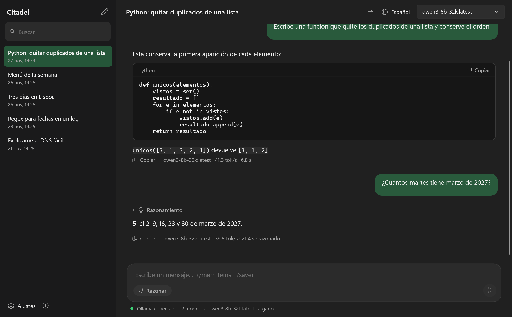
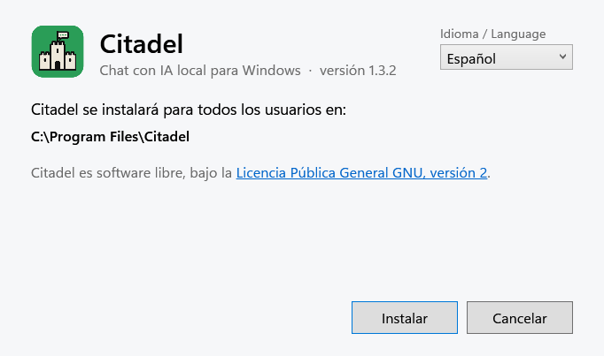
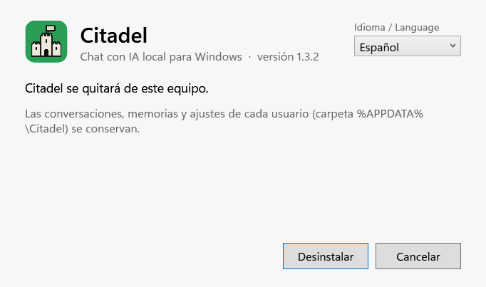
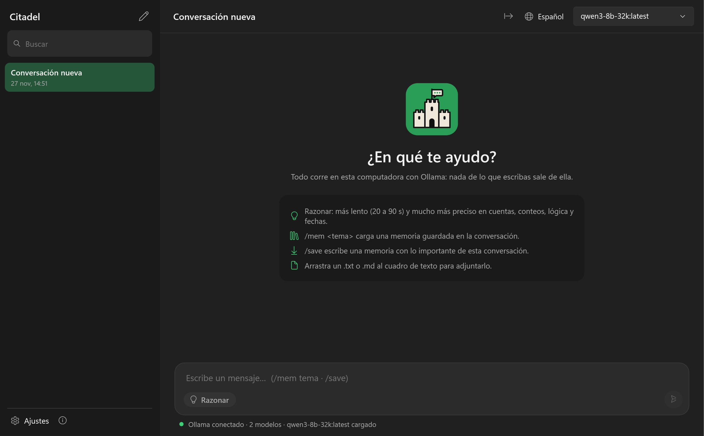
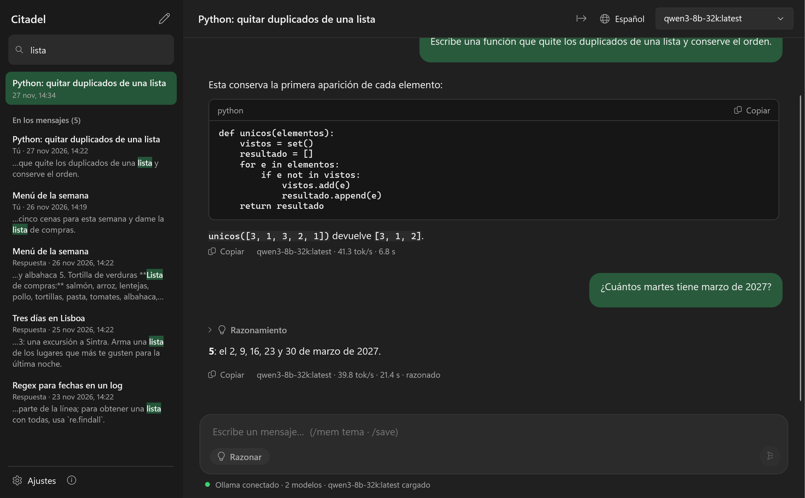
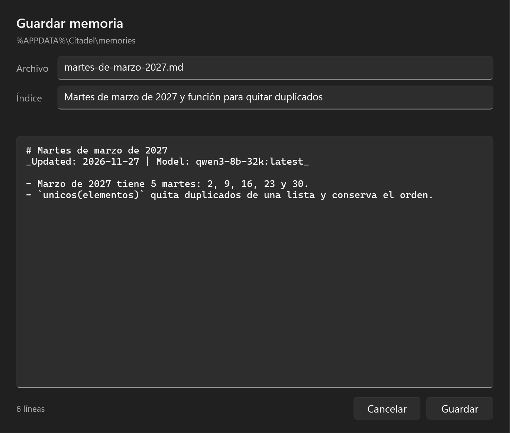
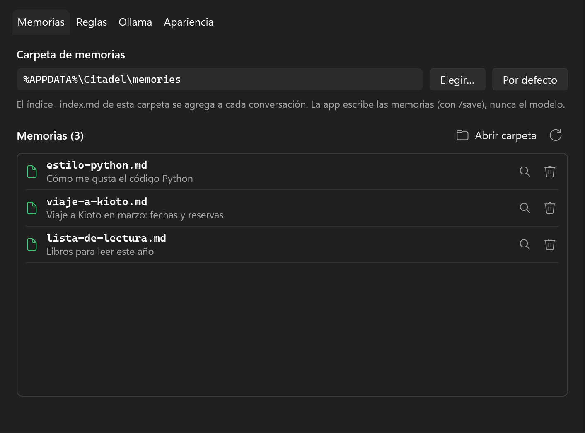
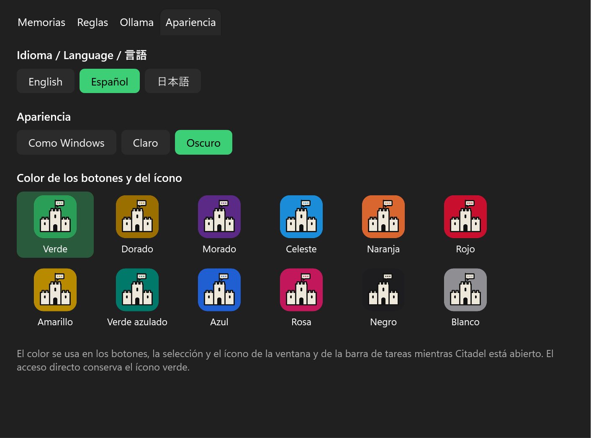
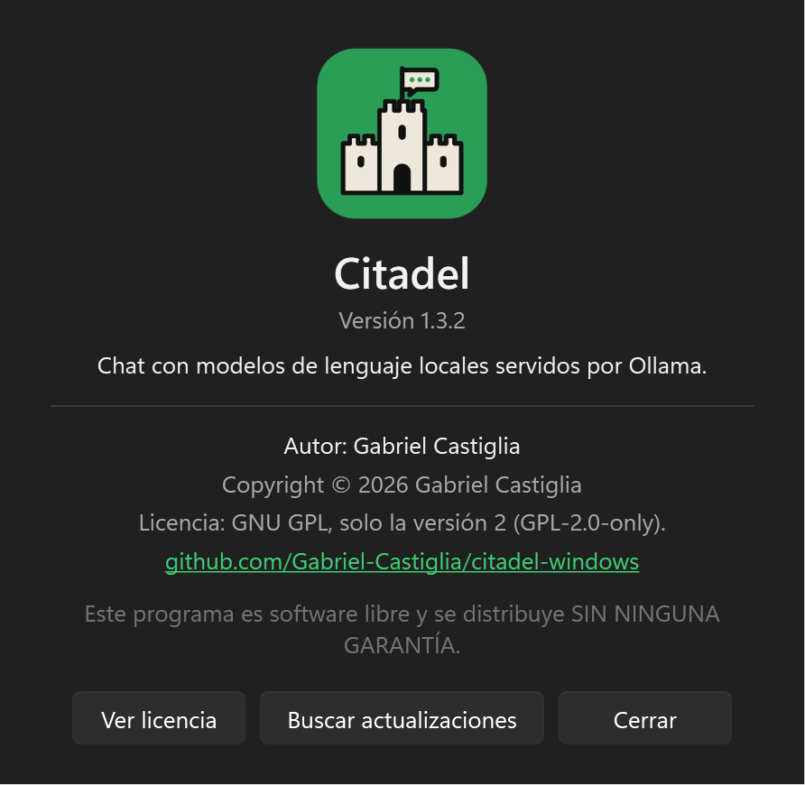

# Citadel para Windows

Gabriel Castiglia · 27 de noviembre de 2026 · versión 1.4.0 · licencia GPL-2.0

[English](README.md) · Español · [日本語](README.ja.md)

Repositorio: <https://github.com/Gabriel-Castiglia/citadel-windows>

Manual en PDF: [`docs/Citadel-manual-es.pdf`](docs/Citadel-manual-es.pdf)

Citadel es una app de chat para Windows 10 y 11 que conversa con modelos de lenguaje que corren en la
misma computadora mediante [Ollama](https://ollama.com). Nada de lo que escribes sale de la computadora:
la app solo se conecta con Ollama en `127.0.0.1:11434`, salvo que elijas usar el Ollama de otra
computadora tuya por SSH (ver [Ollama en otra computadora](#ollama-en-otra-computadora)); la única
otra conexión es la búsqueda diaria de una versión nueva en GitHub (ver
[Actualizaciones](#actualizaciones)), que no envía nada tuyo. Está escrita en C# con .NET 10 y WPF, usa
el estilo de Windows 11, oscuro, claro o como Windows, en uno de doce colores, y su interfaz está en
inglés, en español y en japonés. La versión para macOS, con las mismas funciones, tiene su propio repositorio:
<https://github.com/Gabriel-Castiglia/citadel>.

Citadel es una ventana de chat, no un agente. El modelo no puede abrir archivos, ejecutar comandos ni
navegar por la web. Recibe lo que escribes, los archivos de texto que adjuntas, unas reglas que van con
cada pedido y, cuando lo pides, una de tus memorias guardadas.



## Requisitos

- Windows 11, o Windows 10 versión 1803 o posterior, de 64 bits.
- Ollama para Windows, desde <https://ollama.com/download>. Su instalador lo deja funcionando en segundo
  plano y arrancando con Windows (su ícono de llama queda en el área de notificación). Después se
  descarga un modelo, en PowerShell:

  ```
  ollama pull qwen3:8b
  ```

Citadel arranca con el modelo `qwen3-8b-32k:latest` elegido si está instalado y, si no, con el primero
que liste Ollama. Ese nombre es Qwen3 8B con un contexto de 32.768 tokens, creado así:

```
Set-Content Modelfile "FROM qwen3:8b`nPARAMETER num_ctx 32768"
ollama create qwen3-8b-32k -f Modelfile
```

Qwen3 8B necesita unos 7 GB de memoria mientras está cargado. La velocidad de las respuestas depende de
la tarjeta gráfica: sin una que Ollama admita, el modelo corre en el procesador y contesta mucho más
despacio.

No hace falta instalar nada más. Citadel trae su propio entorno de .NET, y la ventana de instalación
usa el .NET Framework que Windows ya incluye.

## Instalación

Hay tres formas de obtener Citadel; las tres las genera `scripts\build.ps1` en la carpeta `dist`:

| Archivo | Qué es |
|---|---|
| `citadel-setup.exe` | Programa de instalación, en inglés, en español o en japonés. La forma habitual de instalar. |
| `citadel.msi` | La misma instalación como paquete de Windows Installer, para instalar sin ventanas: `msiexec /i citadel.msi /qn`. |
| `Citadel.exe` | El programa solo; funciona sin instalar desde cualquier carpeta. |

El programa de instalación abre una ventana con un menú de idioma arriba a la derecha (empieza en el
idioma de Windows si es español o japonés, y si no en inglés), y cada página cambia de idioma al
instante. Instala Citadel para todos los usuarios en `C:\Program Files\Citadel`, lo
que requiere permisos de administrador (Windows los pide al empezar la instalación), y agrega Citadel al
menú Inicio. El idioma elegido en la ventana de instalación es el que Citadel usa la primera vez que
arranca.



Ejecutar un `citadel-setup.exe` más nuevo actualiza el Citadel instalado y conserva las conversaciones,
las memorias y los ajustes de cada usuario. Si Citadel está abierto, la instalación lo cierra antes de
reemplazar sus archivos. Una versión más vieja no se puede instalar encima de una más nueva.

### Actualizaciones

Citadel busca una versión nueva una vez por día, unos segundos después de arrancar, y Acerca de → Buscar
actualizaciones busca en el momento. Si un Citadel instalado encuentra una, hace una sola pregunta:
Actualizar ahora, Ver novedades (abre la página de la versión) o Más tarde. Actualizar ahora hace el resto solo: comprueba que el `SHA256SUMS.txt` de la versión
lleve la firma del autor (`release.sig`, que se comprueba con dos claves que trae Citadel; una versión sin firma
válida no instala nada y solo se puede bajar a mano desde su página), descarga `citadel-setup.exe` y lo
comprueba con ese `SHA256SUMS.txt` (un archivo que no coincide se borra y nunca se ejecuta),
cierra Citadel, instala la versión nueva en silencio con el idioma elegido al instalar Citadel y vuelve a
abrirlo. Windows pide permisos de administrador, como en cualquier instalación. Si se está escribiendo
una respuesta, Citadel primero pregunta si esperarla o detenerla, así queda guardada en su conversación;
el texto que se estaba escribiendo, sus adjuntos y la conversación abierta vuelven después del reinicio.
Después de la actualización, un aviso arriba de la ventana dice «Citadel se actualizó a la versión …». Si
la instalación falla o se rechaza, se vuelve a abrir la versión anterior.

El `Citadel.exe` independiente no puede actualizarse solo: cuando hay una versión nueva ofrece Abrir la
página o Más tarde.

Los archivos no están firmados con un certificado comercial, así que la primera vez Windows SmartScreen
puede mostrar «Windows protegió su PC». «Más información» → «Ejecutar de todas formas» los abre.

## Desinstalación

Abre Configuración de Windows → Aplicaciones → Aplicaciones instaladas, busca Citadel y elige
Desinstalar. Se abre la misma ventana de instalación, con su menú de idioma. Cierra Citadel si está
abierto y quita el programa y el acceso del menú Inicio.

Los datos de cada usuario, en `%APPDATA%\Citadel`, se conservan, así una instalación posterior los
encuentra. Para borrarlos también, elimina esa carpeta.

Para desinstalar sin ventanas: `citadel-setup.exe /uninstall /quiet`.



## Uso



Escribe en el cuadro de abajo y pulsa Enter para enviar. Shift+Enter (o Alt+Enter) empieza una línea
nueva. La respuesta aparece a medida que se escribe, con formato Markdown: títulos, listas, tablas,
citas, negrita, código en línea, enlaces y bloques de código en un recuadro de letra monoespaciada con su
propio botón Copiar. Un enlace se abre en el navegador, y al pasar el puntero por encima muestra su
dirección. La respuesta entera se puede seleccionar con el mouse. Debajo de cada respuesta están el
botón Copiar de la respuesta entera, el modelo, su velocidad en tokens por segundo y los segundos que
tardó.

Citadel abre una sola ventana: si lo vuelves a abrir (desde el menú Inicio, por ejemplo), trae al frente
la ventana que ya está abierta, restaurada si estaba minimizada. La ventana se abre donde se cerró y con
el mismo tamaño, maximizada si estaba maximizada.

### Conversaciones

La barra lateral lista las conversaciones, de la más nueva a la más vieja. Ctrl+N o el botón del lápiz
empiezan una nueva, cuyo título es la primera línea del primer mensaje. Con clic derecho sobre una
conversación aparecen Renombrar…, Exportar a Markdown… y Eliminar…; eliminar pide confirmación y borra
su archivo del disco, y no se puede deshacer.

### Búsqueda

El campo de búsqueda (Ctrl+F) busca en todas las conversaciones guardadas, sin distinguir mayúsculas,
tildes ni saltos de línea. Primero aparecen las conversaciones cuyo título coincide; debajo, en «En los
mensajes», cada mensaje que contiene el texto (lo que escribiste o una respuesta) aparece con su
conversación, su fecha y las palabras alrededor de la coincidencia, resaltada. Un clic en un resultado
abre esa conversación en ese mensaje.



### Exportar a Markdown

El botón de exportar del encabezado, junto al idioma, guarda la conversación que se ve como un archivo
`.md`; con clic derecho sobre una conversación de la barra lateral se exporta esa. El archivo tiene el
título, la fecha, el modelo y cada turno bajo un encabezado «Usuario» o «Asistente»; las respuestas
conservan su Markdown y sus bloques de código intactos, y los adjuntos y el razonamiento van en bloques
plegados. Con «Abrir después de exportar» marcado en el mismo menú, el archivo se abre con la aplicación
que Windows usa para los `.md`.

### Modelos

La lista de modelos, arriba a la derecha, muestra todos los modelos instalados en Ollama y los vuelve
a leer cada vez que se abre; eliges uno y el próximo mensaje va a ese. La elección se recuerda, y
debajo de cada respuesta figura el modelo que la escribió, así que en una misma conversación se pueden
comparar varios. Para agregar un modelo, instálalo desde una terminal y vuelve a abrir la lista:

```
ollama pull gemma3:12b
```

Sirve cualquier modelo de chat de la [biblioteca de Ollama](https://ollama.com/library). Los modelos
que no pueden razonar (Ollama no incluye «thinking» entre sus capacidades) aparecen en la lista con
«(sin Razonar)», y con uno de ellos elegido el botón Razonar queda atenuado y su ayuda dice por qué.
Citadel le pregunta a Ollama las capacidades de cada modelo al listarlos, así que un modelo nuevo
queda clasificado en cuanto aparece.

Ollama le da a cada modelo una ventana de contexto de unos pocos miles de tokens, salvo que el modelo
indique otra. Para conversaciones largas o adjuntos grandes, crea una variante con una ventana mayor,
como en [Requisitos](#requisitos), y elígela en la lista. Una ventana mayor ocupa más memoria.

### Estado

La línea bajo el cuadro de texto dice si Ollama responde y dónde (en esta computadora, o en otra por
SSH), si el modelo está cargado o se cargará con el próximo mensaje, qué está haciendo (cargando,
razonando, escribiendo) con los segundos transcurridos, y la velocidad de la última respuesta. Cuando
Ollama no responde, esa misma línea dice cómo iniciarlo, o da el error de SSH.

### Razonar

El botón Razonar hace que el modelo piense antes de contestar; mientras está activo se llena con el
color de énfasis. El razonamiento va en un bloque atenuado sobre la respuesta. El bloque queda plegado,
mostrando la última línea mientras el modelo piensa, y se abre con un clic. Razonar es más lento y mucho
más preciso en cuentas, conteos de letras o palabras, lógica y fechas. Sin razonar, el modelo contesta
enseguida y alcanza para explicaciones, redacción, traducción y código. Razonar solo está disponible
con los modelos que saben razonar (ver [Modelos](#modelos)).

Con Razonar activo, una respuesta puede escribir hasta 8.000 tokens; sin él, hasta 3.000. En
[Notas técnicas](#notas-técnicas) están las mediciones que llevaron a esos valores.

### Detener

Mientras se escribe una respuesta, el botón de enviar pasa a ser Detener (también Esc). Cierra la
conexión y Ollama deja de generar; lo escrito hasta ese momento queda, marcado como «Detenido». Esc
también cancela una memoria que `/save` todavía está redactando.

### Adjuntos

Arrastra un archivo `.txt` o `.md` al cuadro de texto para adjuntar su texto al próximo mensaje; una
etiqueta muestra el nombre del archivo y su largo en caracteres, con un botón para quitarlo. Se pueden
adjuntar varios archivos a un mismo mensaje. Los de otro tipo se rechazan con «Solo se pueden adjuntar
archivos .txt o .md.», y un archivo de más de 2 MB, con «<nombre> pesa más de 2 MB: no se adjuntó.». El
texto se lee en la codificación con que se guardó el archivo: la que indica su marca de orden de bytes;
si no tiene, UTF-8; y si no es UTF-8 válido, la página de códigos de Windows para programas que no son
Unicode (como Windows-1252 o Shift_JIS), así un archivo viejo del Bloc de notas no muestra caracteres
rotos.

### Memorias

Una memoria es un archivo Markdown breve en la carpeta de memorias, listado en el `_index.md` de esa
carpeta con una línea por memoria:

```
`viaje-a-kioto.md` — Viaje a Kioto en marzo: fechas y reservas
```

El índice va con cada pedido, así el modelo sabe qué memorias existen. Su contenido no va, hasta que
cargas una:

- `/mem <tema>` busca la memoria cuya línea del índice o nombre de archivo comparte más palabras con el
  tema (sin distinguir tildes ni mayúsculas) y la agrega a la conversación. Una etiqueta muestra
  «memoria cargada:» y el nombre del archivo. Si nada coincide, Citadel lo dice.
- `/save` le pide al modelo que escriba una memoria con la conversación actual: un título, la línea
  `_Updated: AAAA-MM-DD | Model: <modelo>_` y los datos que vale la pena guardar, en el idioma de la
  conversación. Se abre una vista previa donde se pueden corregir el nombre del archivo, la línea del
  índice y el texto. Si el archivo ya existe, la vista previa avisa que se va a reemplazar. Guardar
  escribe el archivo y su línea del índice, los vuelve a leer del disco y solo entonces lo confirma en
  la conversación.



Las memorias las escribe Citadel, no el modelo. Los modelos locales chicos suelen contestar «guardado»
sin guardar nada; por eso el modelo solo redacta el texto, y la app escribe el archivo y lo comprueba.

## Ajustes

El botón Ajustes, abajo en la barra lateral (o Ctrl+,), abre una ventana con cuatro pestañas.



| Pestaña | Qué contiene |
|---|---|
| Memorias | La carpeta de memorias (Elegir…, o Por defecto para volver a `%APPDATA%\Citadel\memories`), la lista de memorias con su línea del índice, Abrir carpeta, Mostrar en el Explorador para cada memoria, y Eliminar, que pide confirmación y borra el archivo y su línea del índice. |
| Reglas | Las reglas que van al principio de cada pedido, editables. Guardar (Ctrl+S) las escribe; Descartar cambios deshace lo editado; Restaurar las originales vuelve a las reglas de fábrica. |
| Ollama | Dónde corre Ollama: en esta computadora (127.0.0.1:11434), o en otra por SSH (ver [Ollama en otra computadora](#ollama-en-otra-computadora)). Aplicar y probar se conecta enseguida y lista los modelos que encuentra. |
| Apariencia | El idioma de la interfaz (ver [Idioma](#idioma)), Como Windows, Claro u Oscuro, y el color de los botones y del ícono (ver [Tema y color](#tema-y-color)). |

Si cambias el idioma o el tema con Ajustes abierto, la ventana se redibuja sin perder las reglas que
estás editando y todavía no guardaste, ni un destino SSH que todavía no aplicaste.

Cualquier carpeta puede ser la carpeta de memorias, también una que use otra herramienta, mientras
mantenga el mismo formato de `_index.md`.

### Reglas

Cada pedido empieza con un mensaje de sistema formado por el archivo de reglas, el índice de memorias y
las memorias cargadas con `/mem`. El archivo de reglas es `%APPDATA%\Citadel\rules.md` y se crea en el
primer arranque con estas reglas (en inglés, que es como mejor las siguen los modelos chicos):

1. Contestar en el idioma del usuario y exactamente lo que se pidió; si solo se pide el resultado, dar
   solo el resultado.
2. No inventar: si no sabe la respuesta, si es posterior a sus datos de entrenamiento, si es privada o
   trata de algo que quizá no existe, decirlo en una oración.
3. Revisar la premisa y avisar primero si es falsa.
4. Formatos exactos: solo JSON, solo una lista o exactamente N elementos quiere decir exactamente eso.
5. Código: un bloque de código Markdown cercado con la función completa, sin `input()` ni llamadas de
   ejemplo.
6. Traducción: dejar sin cambios el texto entre comillas invertidas, las rutas, los comandos, los
   números y los nombres, y contestar solo con la traducción.
7. El modelo corre localmente con Ollama y nada sale de la computadora.

La última regla está porque un modelo local, cuando se le pregunta dónde corre, tiende a contestar que
en la nube, cosa que no puede saber.

## Idioma

La interfaz está en inglés, en español y en japonés. El botón del globo, arriba a la derecha junto a la
lista de modelos, muestra el idioma actual y abre el menú de idioma, y Ajustes → Apariencia tiene la
misma elección bajo «Idioma / Language / 言語»; el cambio se aplica al instante en todas las ventanas
abiertas y se recuerda. En el primer arranque Citadel usa el idioma elegido durante la instalación; si
corre sin instalar, el idioma de Windows si es español o japonés, y si no, inglés. El texto en japonés
usa las fuentes japonesas de Windows (Yu Gothic UI, o Meiryo UI). El idioma de la interfaz no cambia el de las respuestas: el modelo contesta en el
idioma en que le escribes.

## Tema y color

Ajustes → Apariencia elige cómo se ve la ventana: como Windows (clara u oscura, como tus otras apps),
clara u oscura, que es la de fábrica. Debajo, doce colores cambian los botones, la selección y el
resplandor detrás de la ciudadela en el ícono de la ventana y de la barra de tareas mientras Citadel está
abierto; el verde es el original. Los accesos directos del menú Inicio y del escritorio conservan el ícono
verde. El cambio se aplica al instante en todas las ventanas abiertas y se recuerda. La versión para Mac
tiene las mismas opciones.



## Acerca de

El botón ⓘ, abajo en la barra lateral junto a Ajustes, abre Acerca de Citadel: la versión, el autor, la
licencia y la dirección del repositorio, que se abre en el navegador. Ver licencia abre el `LICENSE.txt`
instalado con Citadel (o el sitio de GNU cuando corre sin instalar), Buscar actualizaciones busca una
versión nueva en el momento (ver [Actualizaciones](#actualizaciones)) y Cerrar cierra la ventana.



## Privacidad

- Las conversaciones, las reglas, las memorias y los ajustes son archivos comunes en `%APPDATA%\Citadel`
  (ver [Archivos](#archivos)); nada se envía a un servicio en la nube, y Citadel no tiene cuentas,
  analíticas ni telemetría.
- Los pedidos van solo a Ollama: en esta computadora, o en otra computadora tuya por un túnel SSH.
- La búsqueda diaria de actualizaciones le pide a GitHub la última versión publicada de Citadel; envía la
  versión de Citadel y nada más. Una actualización se instala solo si sus archivos llevan la firma del
  autor.
- El modelo solo ve lo que escribes, los archivos que adjuntas, las reglas, el índice de memorias y las
  memorias que cargas con `/mem`. No puede leer archivos, ejecutar comandos ni navegar por la web.

## Ollama en otra computadora

Un modelo demasiado grande para esta computadora puede correr en otra computadora tuya, y Citadel puede
usarlo por SSH. Citadel abre el comando `ssh` que trae Windows, con un túnel desde un puerto local
libre hasta el puerto 11434 de esa computadora, manda cada pedido por ahí y lo cierra al salir. El
puerto de Ollama nunca se abre a la red: a la otra computadora solo le hace falta aceptar SSH. Las
conversaciones, las reglas y las memorias se quedan en esta computadora; la otra recibe cada pedido
cuando se envía, como pasa siempre con Ollama.

En la computadora que corre el modelo:

1. Instala Ollama y los modelos, como en [Requisitos](#requisitos). A Ollama le basta escuchar en
   `127.0.0.1`, que es lo que hace de fábrica.
2. Enciende el servidor SSH: en una Mac, Ajustes del Sistema → General → Compartir → Sesión remota; en
   Windows, Configuración → Sistema → Características opcionales → Servidor OpenSSH, y después inicia
   el servicio `sshd`.
3. Autoriza la llave pública de esta computadora (`%USERPROFILE%\.ssh\id_ed25519.pub`; si no existe,
   créala con `ssh-keygen -t ed25519`). En el `~/.ssh/authorized_keys` del usuario de la otra
   computadora, una línea como esta deja que esa llave reenvíe el puerto de Ollama y nada más (ni
   terminal, ni comandos, ni otros puertos):

   ```
   restrict,port-forwarding,permitopen="127.0.0.1:11434",command="/usr/bin/false" ssh-ed25519 AAAA… nombre
   ```

   En un servidor Windows ese archivo es `C:\Users\<usuario>\.ssh\authorized_keys` para un usuario
   estándar, o `C:\ProgramData\ssh\administrators_authorized_keys` para un administrador, y el
   comando forzado es `command="cmd /c exit"`.

En esta computadora, abre Ajustes → Ollama, elige «En otra computadora, por SSH», escribe el destino
(`usuario@equipo`, o un nombre `Host` de `%USERPROFILE%\.ssh\config`) y haz clic en Aplicar y
probar. La línea de resultado lista los modelos que hay allá, y la línea de estado bajo el cuadro de
texto dice «Ollama en <equipo> (SSH)». Citadel nunca pide contraseña (corre ssh en modo por lotes),
así que la llave tiene que funcionar sin una o estar cargada en el agente de OpenSSH. La primera
conexión a un equipo nuevo guarda su llave en `known_hosts`; si esa llave cambia después, la conexión
falla, como en cualquier cliente SSH. Si la conexión se corta, Citadel la vuelve a abrir con el pedido
siguiente.

## Teclado

| Teclas | Acción |
|---|---|
| Enter | Enviar |
| Shift+Enter, Alt+Enter | Línea nueva |
| Ctrl+N | Conversación nueva |
| Ctrl+F | Buscar en las conversaciones |
| Esc | Detener la respuesta (o la memoria que se está redactando) |
| Ctrl+, | Ajustes |
| Ctrl+S | Guardar las reglas (pestaña Reglas) |
| Tab, Shift+Tab | Pasar por los cuadros de texto, las listas y los botones, también los que son solo un ícono; el botón que tiene el foco muestra un borde del color de énfasis, y Espacio o Enter lo pulsa |

## Solución de problemas

| Qué aparece | Qué hacer |
|---|---|
| La línea de estado dice «Ollama no responde en 127.0.0.1:11434. Ábrelo desde el menú Inicio o ejecuta: ollama serve» (o un mensaje dice «No se puede conectar con Ollama…») | Ollama no está corriendo. Ábrelo desde el menú Inicio (su ícono aparece en el área de notificación) o ejecuta `ollama serve` en PowerShell. Citadel vuelve a comprobar cada pocos segundos y la línea de estado pasa sola a «Ollama conectado». |
| La lista de modelos está vacía | Ollama todavía no tiene modelos: ejecuta `ollama pull qwen3:8b` (u otro modelo) y vuelve a abrir la lista. |
| Un modelo aparece con «(sin Razonar)» y el botón Razonar está atenuado | Ese modelo no sabe razonar. Elige otro, como Qwen3, para usar Razonar. |
| Las respuestas son muy lentas | El modelo corre en el procesador o no entra en la memoria de la tarjeta gráfica. Prueba un modelo más chico; la primera respuesta después de arrancar incluye además el tiempo de cargar el modelo. |
| El modelo se olvida del principio de una conversación larga o de un adjunto grande | Su ventana de contexto es demasiado chica: crea una variante con un `num_ctx` mayor, como en [Requisitos](#requisitos). |
| «SSH a … falló» o «no respondió en 20 s» | Revisa el destino, que la otra computadora acepte SSH y que `ssh <destino>` funcione en PowerShell sin pedir contraseña. Ver [Ollama en otra computadora](#ollama-en-otra-computadora). |
| `/save` dice «El modelo no devolvió un JSON válido.» | A los modelos chicos a veces les pasa; vuelve a probar `/save` o usa otro modelo. No se escribió nada. |
| «Ollama devolvió una respuesta que no se entiende.» | Lo que contesta en `127.0.0.1:11434` (o por el túnel SSH) no es Ollama, o es una versión muy vieja. Cierra el otro programa que usa ese puerto, o actualiza Ollama desde <https://ollama.com/download>. |
| Windows SmartScreen dice «Windows protegió su PC» | «Más información» → «Ejecutar de todas formas» (ver [Actualizaciones](#actualizaciones)). |
| Falla otra cosa | Los detalles están en `%APPDATA%\Citadel\citadel.log`. |

## Archivos

| Qué | Dónde |
|---|---|
| Programa instalado | `C:\Program Files\Citadel`, con `LICENSE.txt`, `README.txt`, `README.es.txt` y `README.ja.txt` |
| Conversaciones | `%APPDATA%\Citadel\conversations\`, un archivo JSON cada una |
| Reglas | `%APPDATA%\Citadel\rules.md` |
| Memorias (carpeta por defecto) | `%APPDATA%\Citadel\memories\`, con `_index.md` |
| Ajustes (idioma, modelo, Razonar, carpeta de memorias, dónde corre Ollama y destino SSH, apariencia, color, «Abrir después de exportar», posición de la ventana y si estaba maximizada) | `%APPDATA%\Citadel\settings.json` |
| Registro de errores, si algo falla | `%APPDATA%\Citadel\citadel.log`; al pasar de 512 KB pasa a llamarse `citadel.old.log` y empieza uno nuevo |
| Fecha de la última búsqueda de actualizaciones | `%APPDATA%\Citadel\update-check.txt` |
| Actualización descargada, y el texto que se estaba escribiendo mientras se instala | `%TEMP%\CitadelUpdate\` |

Los archivos se escriben en UTF-8 sin marca de orden de bytes. Las conversaciones son JSON simple con el
mismo formato que la versión para macOS, así que se pueden copiar de una a otra.

## Compilar desde el código

Con el [SDK de .NET 10](https://dotnet.microsoft.com/download) instalado:

```
dotnet build src\Citadel\Citadel.csproj -c Release
powershell -ExecutionPolicy Bypass -File scripts\build.ps1
```

El primer comando compila el programa. El segundo genera todo en `dist`: el `Citadel.exe` independiente,
`citadel.msi` y `citadel-setup.exe`; el WiX Toolset 5 se descarga solo como paquete de NuGet. El script no
escribe sumas de comprobación ni firma nada: `SHA256SUMS.txt` y su firma, `release.sig`, con los que las
actualizaciones comprueban el instalador, se calculan y se publican aparte al crear la versión. La versión
se fija en un solo lugar, `src\Citadel\Citadel.csproj`, y los instaladores y la ventana Acerca de la leen
de ahí.

El programa tiene dos modos para mantenimiento. Los dos aceptan `--data-folder <carpeta>` para usar otra
carpeta en lugar de `%APPDATA%\Citadel`, así nunca tocan las conversaciones reales.

- `Citadel.exe --self-test --memory-folder <carpeta vacía>` prueba de punta a punta las funciones
  principales contra Ollama e imprime una línea PASS o FAIL por cada control: la lista de modelos, una
  respuesta sin Razonar y otra con Razonar, Detener, `/save` (archivo, línea del índice, sin marca de
  orden de bytes) y `/mem`. Se niega a correr sobre una carpeta de memorias en uso. Antes, y sin Ollama,
  comprueba los textos de la interfaz (cada texto del programa, leído del código compilado, está en los
  tres idiomas con las mismas marcas, como `{0}`, comandos, teclas y nombres de archivo), las etiquetas
  `<think>` partidas entre dos fragmentos de una respuesta, las codificaciones de los adjuntos, la búsqueda, la exportación a Markdown (contra el archivo esperado) y las comprobaciones de
  las actualizaciones (comparación de versiones, `SHA256SUMS.txt`, la respuesta de la versión, una
  descarga que no coincide), con conversaciones inventadas en una carpeta temporal;
  `--self-test --offline` corre solo estas. Su salida se lee con `Start-Process Citadel.exe -ArgumentList ... -Wait -NoNewWindow -RedirectStandardOutput out.txt`.
- `Citadel.exe --screenshot <archivo.png> --window main|settings|about|save --language en|es|ja` dibuja
  una ventana en una imagen y se cierra (las rutas dentro de `--data-folder` se muestran como
  `%APPDATA%\Citadel`, como en una instalación real); `--search <texto>` muestra la barra lateral con los resultados de
  una búsqueda, `--tab 0|1|2|3` abre esa pestaña de Ajustes, y `--appearance auto|light|dark` y
  `--accent <color>` (green, gold, purple, sky, ember, red, yellow, teal, blue, pink, black, white)
  eligen el aspecto.

`citadel-setup.exe /quiet /norestart /CITADELWAITPID=<pid> /CITADELRELAUNCH=1` es como una actualización
ejecuta la instalación: espera a que ese proceso de Citadel se cierre antes de reemplazar nada y vuelve a
abrir Citadel al terminar.

`scripts\screenshots.ps1 -Demo <carpeta>` genera las imágenes de `docs\images` con conversaciones y
memorias de demostración (en una carpeta temporal, nunca en `%APPDATA%\Citadel`), `scripts/manual.sh`
(en macOS o en Git Bash en Windows, con pandoc y Google Chrome) genera los tres manuales en PDF y
`README.txt`, `README.es.txt` y `README.ja.txt` a partir de `README.md`, de este archivo y de
`README.ja.md`, y
`scripts/make-icon.sh` (en macOS) arma `src\Citadel\citadel.ico` a partir de `icon\citadel-1024.png`.

| Carpeta | Contenido |
|---|---|
| `src/Citadel` | El programa. |
| `installer/Msi` | El paquete MSI (WiX). |
| `installer/SetupUI` | La ventana de instalación, en inglés, en español y en japonés (.NET Framework 4.7.2, WPF). |
| `installer/Setup` | El programa de instalación que lleva la ventana y el MSI (paquete de WiX). |
| `scripts` | Compilación, imágenes, ícono y manuales. |
| `icon` | El ícono, en SVG y en PNG de 1024 píxeles. |
| `docs` | Manuales en PDF en inglés, español y japonés, imágenes y la hoja de estilo del manual. |

## Notas técnicas

- Las ventanas usan el tema Fluent de WPF (`Application.ThemeMode`), oscuro o claro según lo elegido, que
  .NET 10 todavía marca como experimental (advertencia WPF0001, silenciada en el archivo del proyecto). El
  color de énfasis es el que se elige en Ajustes → Apariencia (verde de fábrica).
- Las respuestas se muestran en un cuadro de texto enriquecido de solo lectura con un documento de
  flujo, así una respuesta entera se puede seleccionar y copiar. Los bloques de código son recuadros
  incrustados con su propio botón Copiar.
- Las respuestas llegan de `/api/chat` como un objeto JSON por línea. Detener cancela el pedido, lo que
  cierra la conexión; Ollama entonces cancela la generación, como muestra su registro
  (`srv stop: cancel task`). También se atienden los modelos que escriben su razonamiento entre
  etiquetas `<think>` en lugar de usar el campo `thinking`, aunque una etiqueta llegue partida entre dos
  fragmentos de la respuesta.
- En 15 preguntas difíciles de conteo, cuentas, lógica y fechas, hechas dos veces cada una, Qwen3 8B
  acertó 9 de 30 sin razonar y 26 de 30 razonando. Razonando, la respuesta mediana tardó 38 segundos y
  la más lenta 172, en una computadora donde el modelo escribe unos 17 tokens por segundo. A veces el
  modelo entra en un bucle de razonamiento hasta llegar al tope de 8.000 tokens; Detener lo corta.
- `/save` le pide al modelo un JSON (`"format": "json"`) sin razonar y con un tope de 3.000 tokens.
  Después Citadel pasa el nombre del archivo a minúsculas con guiones, reescribe la línea `_Updated` con
  la fecha y el modelo reales, y reemplaza la línea vieja del índice del mismo archivo en lugar de
  agregar otra.
- Ollama contesta con un error («does not support thinking») a un pedido con `"think": true` para un
  modelo sin esa capacidad. Citadel lee las capacidades en `/api/show` y a esos modelos les manda
  `"think": false`, esté como esté el botón Razonar.
- El túnel SSH corre `ssh -N` con `BatchMode=yes`, `ExitOnForwardFailure=yes` y señales de vida cada
  15 segundos; Citadel espera a que el extremo local acepte conexiones antes de enviar. ssh.exe corre
  dentro de un objeto de trabajo que Windows cierra junto con Citadel, así que el túnel termina aunque
  Citadel se cierre a la fuerza.

## Créditos

Citadel usa [Ollama](https://ollama.com) (licencia MIT) para correr los modelos, que se descargan aparte
con sus propias licencias. Qwen3 lo publica el equipo de Qwen con licencia Apache 2.0. `Citadel.exe`
trae el entorno de [.NET](https://dotnet.microsoft.com) (licencia MIT). Los instaladores se arman con el
[WiX Toolset](https://wixtoolset.org) (licencia MS-RL), cuya biblioteca para ventanas de instalación usa
la ventana de instalación.

## Historial de versiones

Ver [`CHANGELOG.es.md`](CHANGELOG.es.md).

## Licencia

Copyright (C) 2026 Gabriel Castiglia.

Citadel es software libre: puedes redistribuirlo o modificarlo según los términos de la Licencia Pública
General de GNU, solo la versión 2 (GPL-2.0-only), publicada por la Free Software Foundation. Se
distribuye SIN NINGUNA GARANTÍA. El texto completo está en [`LICENSE`](LICENSE).
