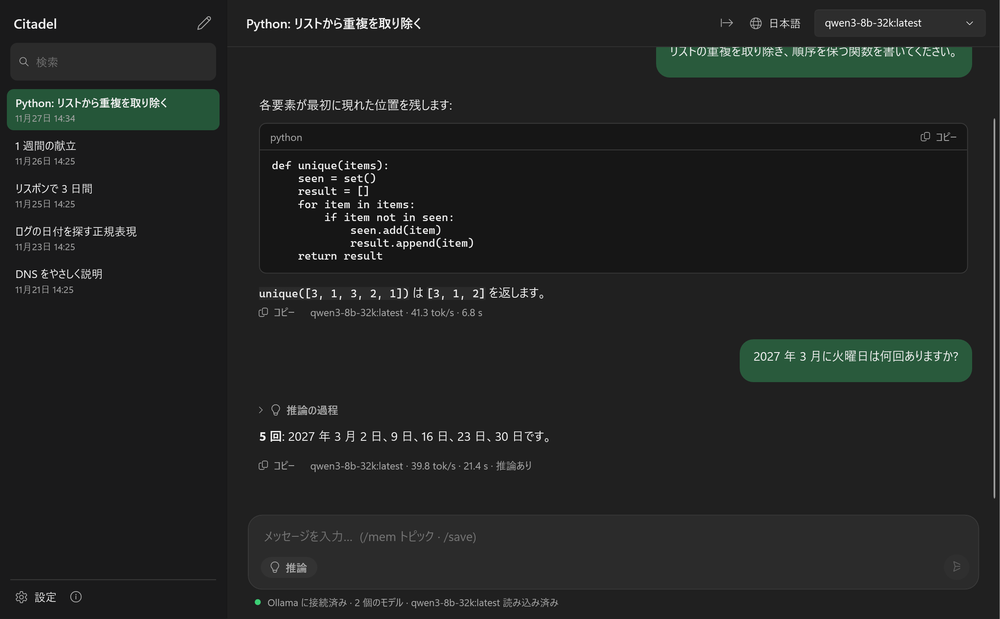
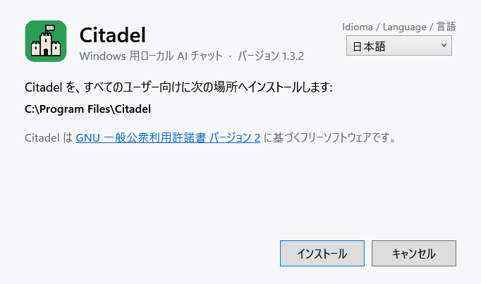
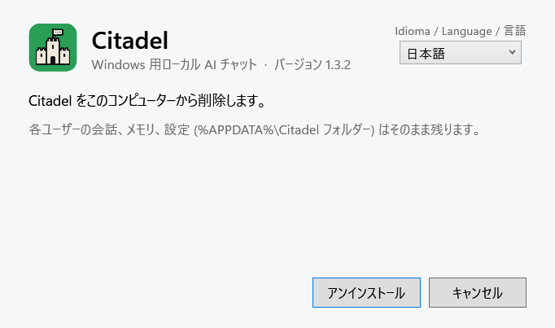
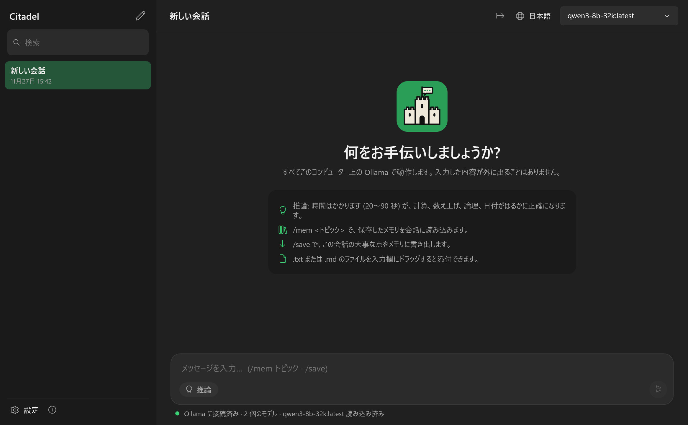
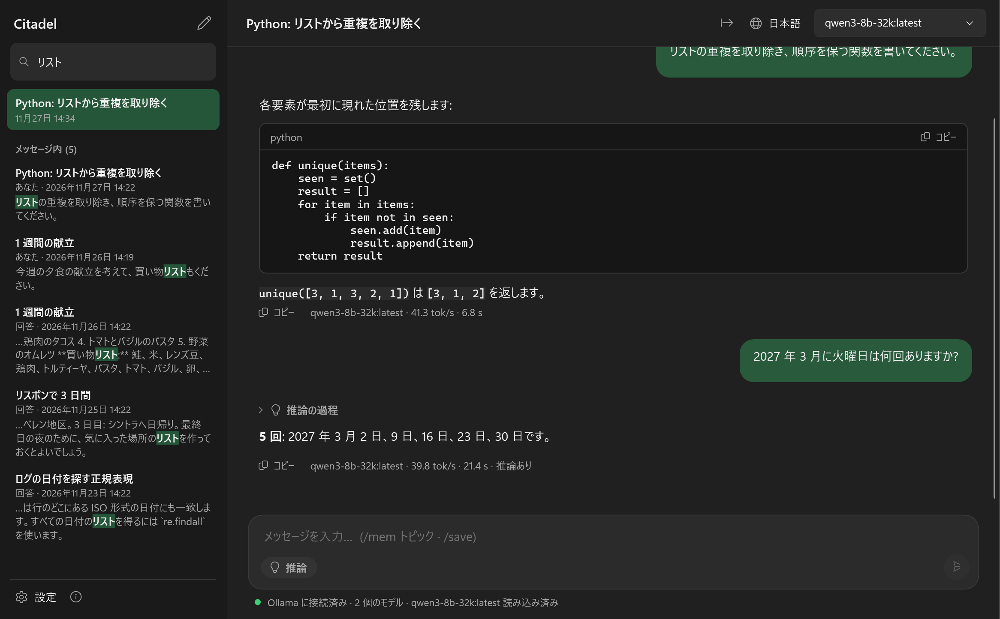
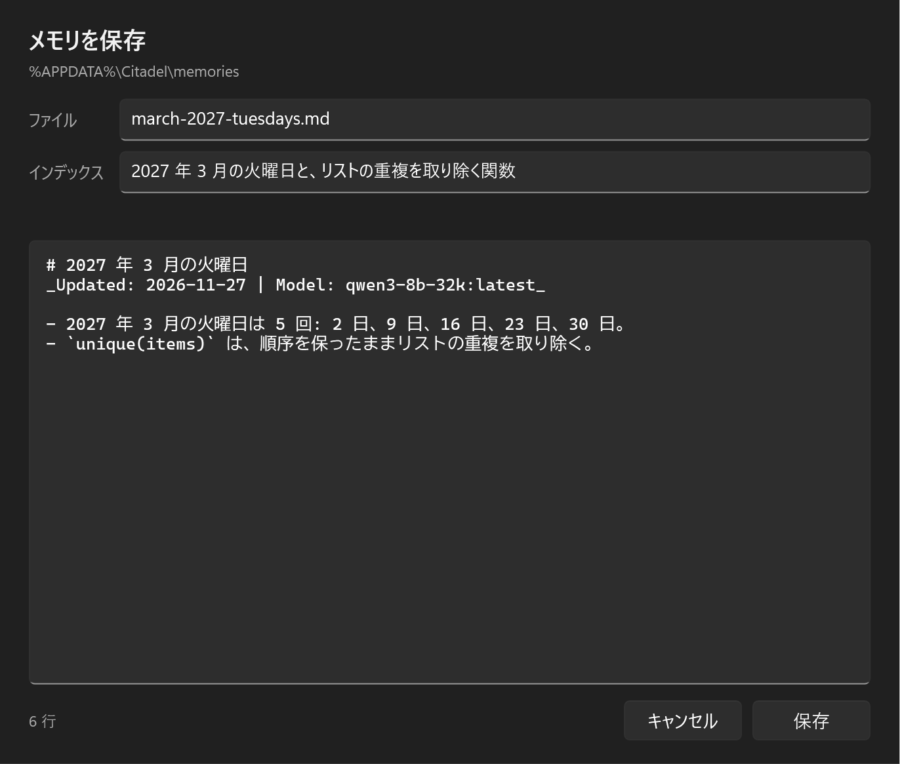
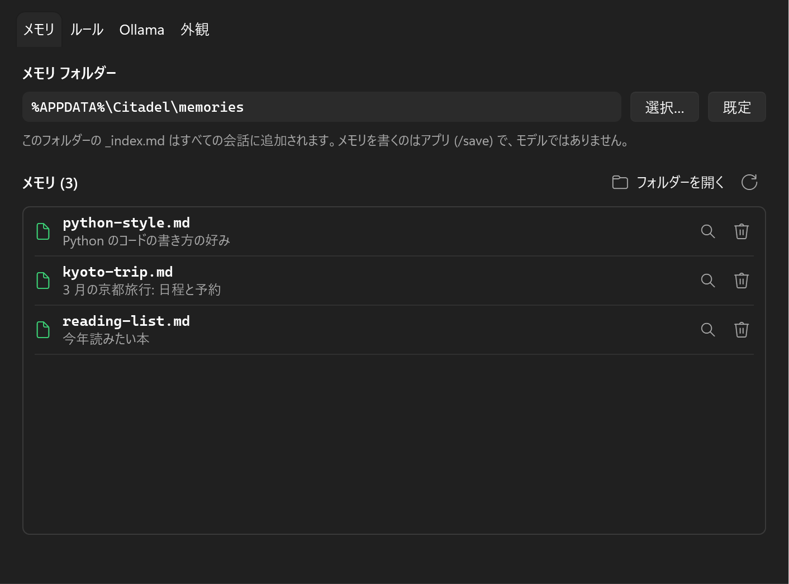
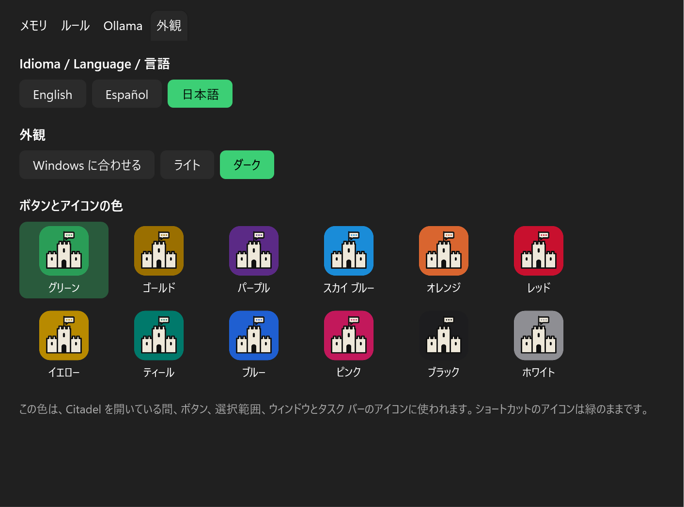
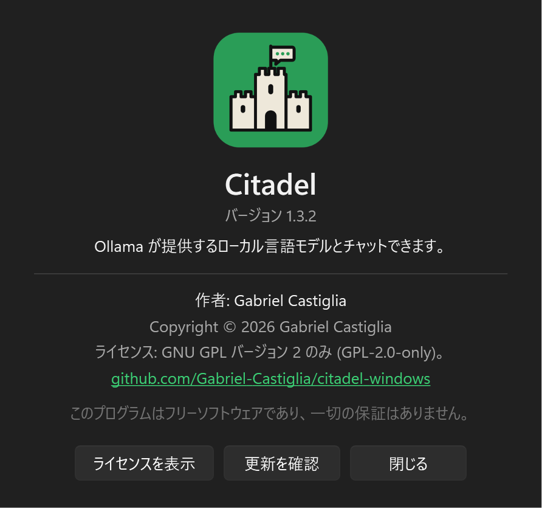

# Citadel for Windows

Gabriel Castiglia · 2026 年 11 月 27 日 · バージョン 1.4.0 · GPL-2.0 ライセンス

[English](README.md) · [Español](README.es.md) · 日本語

リポジトリ: <https://github.com/Gabriel-Castiglia/citadel-windows>

PDF マニュアル: [`docs/Citadel-manual-ja.pdf`](docs/Citadel-manual-ja.pdf)

Citadel は、同じコンピューターで動く言語モデルと [Ollama](https://ollama.com) を通じて会話する、Windows 10 と 11 用のチャット アプリです。入力した内容はコンピューターの外に出ません。アプリが接続するのは `127.0.0.1:11434` の Ollama だけです（SSH 経由で自分の別のコンピューターの Ollama を使うことを選んだ場合を除きます。[別のコンピューターの Ollama](#別のコンピューターの-ollama) を参照）。それ以外の接続は、GitHub で新しいバージョンを 1 日 1 回確認する通信だけで、利用者のデータは何も送りません（[更新](#更新)を参照）。C# と .NET 10、WPF で書かれ、Windows 11 のスタイル（ダーク、ライト、または Windows に合わせる）と 12 色のアクセント カラーを使い、画面は日本語、英語、スペイン語に対応しています。同じ機能を持つ macOS 版は、別のリポジトリ <https://github.com/Gabriel-Castiglia/citadel> にあります。

Citadel はチャットのウィンドウであって、エージェントではありません。モデルはファイルを開いたり、コマンドを実行したり、Web を閲覧したりできません。モデルが受け取るのは、入力した文章、添付したテキスト ファイル、毎回のリクエストとともに送るルール、そして求めたときに読み込む保存済みのメモリ 1 件です。



## 動作環境

- Windows 11、または Windows 10 バージョン 1803 以降（64 ビット）。
- Windows 版 Ollama（<https://ollama.com/download>）。インストーラーは Ollama をバックグラウンドで動かし、Windows の起動時に開始するよう設定します（通知領域にラマのアイコンが表示されます）。続いて PowerShell でモデルをダウンロードします。

  ```
  ollama pull qwen3:8b
  ```

Citadel は、モデル `qwen3-8b-32k:latest` がインストールされていればそれを選んだ状態で起動し、なければ Ollama が最初に挙げるモデルを選びます。この名前は、コンテキストを 32,768 トークンにした Qwen3 8B で、次のように作成します。

```
Set-Content Modelfile "FROM qwen3:8b`nPARAMETER num_ctx 32768"
ollama create qwen3-8b-32k -f Modelfile
```

Qwen3 8B は、読み込まれている間に約 7 GB のメモリーを使います。回答の速さはグラフィックス カードによって決まります。Ollama が対応するカードがない場合、モデルはプロセッサーで動き、回答はかなり遅くなります。

ほかに何もインストールする必要はありません。Citadel は自前の .NET ランタイムを含み、セットアップのウィンドウは Windows に標準で入っている .NET Framework で動きます。

## インストール

Citadel の入手方法は 3 つあり、どれも `scripts\build.ps1` が `dist` フォルダーに作成します。

| ファイル | 内容 |
|---|---|
| `citadel-setup.exe` | 日本語、英語、スペイン語のセットアップ プログラム。通常はこれでインストールします。|
| `citadel.msi` | 同じインストールを Windows インストーラー パッケージにしたもの。ウィンドウなしのインストール用です: `msiexec /i citadel.msi /qn`。|
| `Citadel.exe` | プログラム単体。インストールせずに、どのフォルダーからでも実行できます。|

セットアップ プログラムのウィンドウには、右上に言語メニュー（「Idioma / Language / 言語」）があります。最初は Windows の言語が日本語かスペイン語ならその言語で、それ以外なら英語で表示され、言語を切り替えるとすべてのページがすぐにその言語に変わります。Citadel はすべてのユーザー向けに `C:\Program Files\Citadel` へインストールされるため、管理者権限が必要です（インストールの開始時に Windows が確認します）。スタート メニューにも Citadel が追加されます。セットアップで選んだ言語が、Citadel を初めて起動したときの画面の言語になります。



新しい `citadel-setup.exe` を実行すると、インストール済みの Citadel が更新され、各ユーザーの会話、メモリ、設定はそのまま残ります。Citadel が実行中なら、ファイルを置き換える前にセットアップが閉じます。新しいバージョンの上に古いバージョンをインストールすることはできません。

### 更新

Citadel は起動の数秒後に 1 日 1 回、新しいバージョンを確認します。［Citadel について］の［更新を確認］を選ぶとすぐに確認します。インストール済みの Citadel が新しいバージョンを見つけると、1 回だけ［今すぐ更新］、［新機能を見る］（リリースのページを開きます）、［後で］のどれにするかをたずねます。［今すぐ更新］を選ぶと、あとはすべて自動です。リリースの `SHA256SUMS.txt` に作者の署名があることを確認し（`release.sig` を Citadel に組み込まれた 2 つの鍵で検証します。有効な署名のないリリースは何もインストールせず、そのページから手動でダウンロードするしかありません）、`citadel-setup.exe` をダウンロードしてその `SHA256SUMS.txt` と照合し（一致しないファイルは削除され、実行されません）、Citadel を閉じ、Citadel をインストールしたときの言語で新しいバージョンを自動でインストールして、Citadel を再び開きます。どのインストールとも同じく、Windows が管理者権限を確認します。回答の生成中なら、Citadel はまず［完了を待つ］か［停止して更新］かをたずね、回答はその会話に保存されます。入力中のテキスト、その添付ファイル、開いていた会話は再起動後に戻ります。更新のあとは、ウィンドウの上部に「Citadel をバージョン … に更新しました。」と表示されます。インストールが失敗したり拒否されたりした場合は、以前のバージョンが再び開きます。

単体の `Citadel.exe` は自分自身を更新できません。新しいバージョンがあると、［ページを開く］か［後で］を案内します。

ファイルには商用の証明書による署名がないため、初回は Windows SmartScreen が「Windows によって PC が保護されました」と表示することがあります。「詳細情報」→「実行」で開けます。

## アンインストール

Windows の［設定］→［アプリ］→［インストールされているアプリ］で Citadel を探し、［アンインストール］を選びます。言語メニュー付きの同じセットアップのウィンドウが開きます。Citadel が実行中なら閉じてから、プログラムとスタート メニューのショートカットを削除します。

各ユーザーのデータ（`%APPDATA%\Citadel`）は残るので、あとで再インストールしたときにそのまま使えます。データも削除するには、このフォルダーを削除します。

ウィンドウなしでアンインストールするには: `citadel-setup.exe /uninstall /quiet`。



## Citadel の使い方



下の入力欄（「メッセージを入力…」）に入力し、Enter キーで送信します。Shift+Enter（または Alt+Enter）で改行します。回答は書かれるそばから表示され、Markdown として整形されます: 見出し、箇条書き、表、引用、太字、インライン コード、リンク、そして専用の［コピー］ボタンが付いた等幅フォントの枠に入るコード ブロック。リンクは Web ブラウザーで開き、マウス ポインターを合わせるとそのアドレスが表示されます。回答全体をマウスで選択できます。各回答の下には、回答全体の［コピー］ボタン、モデル名、1 秒あたりのトークン数で表した速度、かかった秒数が表示されます。

Citadel のウィンドウは 1 つだけです。開いている状態でもう一度起動すると（スタート メニューからなど）、開いているウィンドウが前面に表示されます（最小化されていれば元のサイズに戻ります）。ウィンドウは前回閉じた位置とサイズで開き、最大化して閉じた場合は最大化して開きます。

### 会話

サイドバーには会話が新しい順に並びます。Ctrl+N または鉛筆のボタン（［新しい会話］）で新しい会話を始めます。タイトルは最初のメッセージの 1 行目になります。会話を右クリックすると、［名前の変更…］、［Markdown にエクスポート…］、［削除…］が表示されます。削除は確認のあとでファイルをディスクから消し、元に戻せません。

### 検索

検索欄（Ctrl+F）は、保存したすべての会話を、大文字と小文字、アクセント記号、改行を区別せずに検索します。タイトルが一致する会話が先に並び、その下の「メッセージ内」に、その文字列を含むメッセージ（「あなた」の入力または「回答」）が、会話名、日付、一致箇所の前後の語句とともに強調表示されます。結果をクリックすると、その会話のそのメッセージが開きます。



### Markdown へのエクスポート

ヘッダーの言語ボタンの隣にあるエクスポートのボタン（［Markdown にエクスポート］）は、表示中の会話を `.md` ファイルとして保存します。サイドバーで会話を右クリックすると、その会話をエクスポートできます。ファイルにはタイトル、日付、モデル、そして「ユーザー」と「アシスタント」の見出しの下に各発言が入ります。回答の Markdown とコード ブロックはそのまま残り、添付ファイルと推論の過程は折りたたまれたブロックに入ります。同じメニューの［エクスポート後に開く］をオンにすると、Windows が `.md` ファイルに使うアプリでファイルが開きます。

### モデル

右上のモデルの一覧には Ollama にインストールされたすべてのモデルが表示され、開くたびに読み直されます。モデルを選ぶと、次のメッセージはそのモデルに送られます。選択は記憶され、各回答の下には書いたモデルが表示されるので、1 つの会話で複数のモデルを比べられます。モデルを追加するには、ターミナルでインストールしてから一覧を開き直します。

```
ollama pull gemma3:12b
```

[Ollama のライブラリ](https://ollama.com/library)のチャット モデルなら、どれでも使えます。推論できないモデル（Ollama が機能の中に「thinking」を挙げないもの）は一覧に「(推論なし)」付きで表示され、それを選んでいる間は［推論］ボタンが淡色表示になり、そのツールヒントに理由が表示されます。Citadel はモデルを一覧にするときに各モデルの機能を Ollama に問い合わせるので、新しいモデルも現れたときから分類されます。

Ollama は、モデル側に指定がなければ、各モデルに数千トークンのコンテキスト ウィンドウを割り当てます。長い会話や大きな添付ファイルには、[動作環境](#動作環境)のようにウィンドウを大きくした派生モデルを作り、一覧で選びます。ウィンドウが大きいほど、多くのメモリーを使います。

### 状態表示

入力欄の下の行には、Ollama が応答するかとその場所（このコンピューター、または SSH 経由の別のコンピューター）、モデルが読み込み済みか次のメッセージで読み込まれるか、モデルが何をしているか（読み込み中、推論中、回答中）と経過秒数、直前の回答の速度が表示されます。Ollama が応答しないときは、同じ行に起動のしかたや SSH のエラーが表示されます。

### 推論

［推論］ボタンを押すと、モデルは答える前に考えます。オンの間、ボタンはアクセント カラーで塗りつぶされます。推論の過程は回答の上の淡色のブロック（「推論の過程」）に入ります。このブロックは折りたたまれたまま、モデルが考えている間は最新の行を表示し、クリックすると開きます。推論は時間がかかりますが、計算、文字や単語の数え上げ、論理、日付についてはずっと正確です。推論なしでは、モデルはすぐに答え、説明、文章作成、翻訳、コードには十分です。推論は推論できるモデルでだけ使えます（[モデル](#モデル)を参照）。

推論がオンのとき、1 つの回答は最大 8,000 トークン、オフのときは最大 3,000 トークンまで書けます。この値の根拠となった計測は[技術的な補足](#技術的な補足)にあります。

### 停止

回答の生成中は、送信ボタンが［停止］ボタンに変わります（Esc キーでも同じ）。接続を閉じ、Ollama は生成を止めます。それまでに書かれた内容は「停止しました」の印付きで残ります。Esc は、`/save` が下書き中のメモリの取り消しにも使えます。

### 添付ファイル

`.txt` または `.md` ファイルを入力欄にドラッグすると、その本文が次のメッセージに添付されます。ファイル名と文字数を示すチップが表示され、［削除］ボタンで外せます。1 つのメッセージに複数のファイルを添付できます。ほかの種類のファイルは「添付できるのは .txt と .md のファイルだけです。」と表示されて受け付けられず、2 MB を超えるファイルは「<ファイル名> は 2 MB を超えているため、添付しませんでした。」と表示されます。テキストは、ファイルが保存されたエンコードで読み込みます。バイト オーダー マーク（BOM）があればそれに従い、なければ UTF-8、UTF-8 として正しくなければ Unicode 対応ではないプログラム用の Windows のコード ページ（日本語の Windows では Shift_JIS）で読むので、古いメモ帳のファイルでも文字化けしません。

### メモリ

メモリは、メモリ フォルダーにある短い Markdown ファイルで、そのフォルダーの `_index.md` に 1 件 1 行で載っています。

```
`kyoto-trip.md` — 3 月の京都旅行: 日程と予約
```

インデックスは毎回のリクエストとともに送られるので、モデルはどのメモリがあるかを知っています。中身は、読み込むまで送られません。

- `/mem <トピック>` は、インデックスの行またはファイル名がトピックともっとも多くの単語を共有するメモリを探し（アクセント記号と大文字小文字は区別しません）、会話に加えます。「読み込んだメモリ:」とファイル名を示すチップが表示されます。一致するものがなければ、Citadel がそう伝えます。単語は空白や記号で区切って比べるので、日本語のトピックは、インデックスの行と同じ語句をそのまま書くか、ファイル名（`kyoto-trip` など）で指定すると確実です。
- `/save` は、現在の会話からメモリを書くようモデルに頼みます: タイトル、`_Updated: YYYY-MM-DD | Model: <モデル>_` の行、残す価値のある事柄を、会話の言語で書きます。プレビュー（「メモリを保存」）が開き、［ファイル］名、［インデックス］の行、本文を編集できます。ファイルがすでにある場合は、置き換えられることがプレビューに表示されます。［保存］を押すとファイルとインデックスの行を書き込み、両方をディスクから読み直してから、会話の中で完了を伝えます。



メモリを書くのは Citadel で、モデルではありません。小さなローカル モデルは、何も保存せずに「保存しました」と答えることがよくあります。そのためモデルは本文の下書きだけをし、ファイルの書き込みと確認はアプリが行います。

## 設定

サイドバーの下の［設定］ボタン（または Ctrl+,）で、4 つのタブがある「Citadel の設定」ウィンドウが開きます。



| タブ | 内容 |
|---|---|
| メモリ | メモリ フォルダー（［選択…］で選ぶか、［既定］で `%APPDATA%\Citadel\memories` に戻す）、インデックスの行付きのメモリの一覧、［フォルダーを開く］、各メモリの［エクスプローラーで表示］、確認のあとでファイルとインデックスの行を削除する［削除］。|
| ルール | 毎回のリクエストの最初に送るルール。編集できます。［保存］（Ctrl+S）で書き込み、［変更を破棄］で編集を取り消し、［既定に戻す］で元のルールに戻します。|
| Ollama | Ollama の実行場所: ［このコンピューター (127.0.0.1:11434)］、または［別のコンピューター (SSH 経由)］（[別のコンピューターの Ollama](#別のコンピューターの-ollama) を参照）。［適用してテスト］ですぐに接続し、見つかったモデルを一覧にします。|
| 外観 | 画面の言語（[言語](#言語)を参照）、［Windows に合わせる］、［ライト］、［ダーク］と、ボタンとアイコンの色（[テーマと色](#テーマと色)を参照）。|

設定ウィンドウを開いたまま言語やテーマを変えても、ウィンドウは描き直されるだけで、編集中で未保存のルールや、まだ適用していない SSH の接続先は失われません。

メモリ フォルダーには、同じ `_index.md` の形式を保つかぎり、ほかのツールが使っているフォルダーを含め、どのフォルダーでも指定できます。

### ルール

毎回のリクエストは、ルールのファイル、メモリのインデックス、`/mem` で読み込んだメモリからなるシステム メッセージで始まります。ルールのファイルは `%APPDATA%\Citadel\rules.md` で、初回起動時に次のルールで作成されます（小さなモデルがもっともよく従う英語で書かれています）。

1. 利用者の言語で、たずねられたことだけに正確に答える。結果だけを求められたら、結果だけを返す。
2. 作り話をしない: 答えがわからない、学習データより後のこと、私的なこと、存在しないかもしれないことについては、そう一文で伝える。
3. 前提を確かめ、誤っていれば最初にそう伝える。
4. 形式を守る: 「JSON だけ」「リストだけ」「ちょうど N 個」は文字どおりの意味。
5. コード: 完全な関数を 1 つの Markdown のコード ブロックに入れ、`input()` や使用例の呼び出しを含めない。
6. 翻訳: バッククォートで囲まれた文字列、パス、コマンド、数値、名前は変えず、翻訳だけを返す。
7. モデルは Ollama でローカルに動いており、何もコンピューターの外に出ない。

最後のルールがあるのは、ローカル モデルにどこで動いているかをたずねると、知りようがないのにクラウドで動いていると答えがちだからです。

## 言語

画面は日本語、英語、スペイン語に対応しています。右上のモデル一覧の隣にある地球儀のボタンは現在の言語（「日本語」）を表示し、言語メニューを開きます。［設定］→［外観］の「Idioma / Language / 言語」でも同じように選べます。切り替えは開いているすべてのウィンドウにすぐ反映され、記憶されます。初回起動時にはセットアップで選んだ言語を使い、インストールせずに実行したときは、Windows の言語が日本語かスペイン語ならその言語、それ以外なら英語を使います。日本語の文字には Windows の日本語フォント（Yu Gothic UI、または Meiryo UI）を使います。画面の言語は回答の言語を変えません。モデルは話しかけた言語で答えるので、どの画面の言語でも日本語でそのまま会話できます。

## テーマと色

［設定］→［外観］で、ウィンドウの見た目を選びます: ［Windows に合わせる］（ほかのアプリと同じくライトかダーク）、［ライト］、［ダーク］（既定）。その下の 12 色（「ボタンとアイコンの色」）は、ボタン、選択範囲、そして Citadel が開いている間のウィンドウとタスク バーのアイコンの色を変えます。グリーンが元の色です。スタート メニューとデスクトップのショートカットは緑のアイコンのままです。変更は開いているすべてのウィンドウにすぐ反映され、記憶されます。Mac 版にも同じ選択肢があります。



## バージョン情報

サイドバーの下、［設定］の隣にある ⓘ ボタンで「Citadel について」が開きます: バージョン、作者、ライセンス、リポジトリのアドレス（ブラウザーで開きます）。［ライセンスを表示］は Citadel とともにインストールされた `LICENSE.txt` を開き（インストールせずに実行しているときは GNU の Web サイト）、［更新を確認］はすぐに新しいバージョンを確認し（[更新](#更新)を参照）、［閉じる］はウィンドウを閉じます。



## プライバシー

- 会話、ルール、メモリ、設定は、`%APPDATA%\Citadel` にある普通のファイルです（[ファイル](#ファイル)を参照）。クラウドのサービスには何も送らず、アカウント、利用状況の分析、テレメトリーもありません。
- リクエストの送り先は Ollama だけです: このコンピューター、または SSH トンネル経由の自分の別のコンピューター。
- 1 日 1 回の更新の確認は、GitHub に Citadel の最新リリースをたずねるもので、送るのは Citadel のバージョンだけです。更新は、ファイルに作者の署名がある場合にだけインストールされます。
- モデルが見るのは、入力した文章、添付したファイル、ルール、メモリのインデックス、`/mem` で読み込んだメモリだけです。ファイルを読んだり、コマンドを実行したり、Web を閲覧したりはできません。

## 別のコンピューターの Ollama

このコンピューターには大きすぎるモデルも、自分の別のコンピューターで動かし、Citadel から SSH 経由で使えます。Citadel は Windows に付属する `ssh` コマンドを起動し、空いているローカル ポートからそのコンピューターのポート 11434 へのトンネルを作り、すべてのリクエストをそこに通し、終了時に閉じます。Ollama のポートがネットワークに公開されることはなく、別のコンピューターは SSH を受け付けるだけで足ります。会話、ルール、メモリはこのコンピューターに残り、別のコンピューターは、Ollama ではいつもそうであるように、送られたリクエストを受け取るだけです。

モデルを動かすコンピューターでの準備:

1. [動作環境](#動作環境)のとおりに Ollama とモデルをインストールします。Ollama は既定どおり `127.0.0.1` で待ち受ければ十分です。
2. SSH サーバーを有効にします: Mac では［システム設定］→［一般］→［共有］→［リモートログイン］、Windows では［設定］→［システム］→［オプション機能］→［OpenSSH サーバー］を追加してから `sshd` サービスを開始します。
3. このコンピューターの公開鍵（`%USERPROFILE%\.ssh\id_ed25519.pub`。なければ `ssh-keygen -t ed25519` で作成）を承認します。別のコンピューターのユーザーの `~/.ssh/authorized_keys` に次のような行を書くと、その鍵には Ollama のポートの転送だけを許し、それ以外（シェル、コマンド、ほかのポート）は許しません。

   ```
   restrict,port-forwarding,permitopen="127.0.0.1:11434",command="/usr/bin/false" ssh-ed25519 AAAA… name
   ```

   Windows のサーバーでは、このファイルは標準ユーザーなら `C:\Users\<ユーザー>\.ssh\authorized_keys`、管理者なら `C:\ProgramData\ssh\administrators_authorized_keys` で、強制するコマンドは `command="cmd /c exit"` です。

このコンピューターでは、［設定］→［Ollama］を開き、［別のコンピューター (SSH 経由)］を選び、接続先（`user@host`、または `%USERPROFILE%\.ssh\config` の `Host` 名）を入力して［適用してテスト］をクリックします。結果の行にそこで見つかったモデルが並び、入力欄の下の状態表示には「<ホスト> の Ollama (SSH)」と表示されます。Citadel はパスワードをたずねない（ssh をバッチ モードで実行する）ので、鍵はパスワードなしで使えるか、OpenSSH のエージェントに読み込まれている必要があります。新しいホストへの最初の接続では、その鍵が `known_hosts` に記録されます。あとでその鍵が変わると、ほかの SSH クライアントと同じく接続は失敗します。接続が切れた場合は、次のリクエストのときに Citadel が開き直します。

## キーボード

| キー | 操作 |
|---|---|
| Enter | 送信 |
| Shift+Enter、Alt+Enter | 改行 |
| Ctrl+N | 新しい会話 |
| Ctrl+F | 会話の検索 |
| Esc | 回答（または下書き中のメモリ）を停止 |
| Ctrl+, | 設定 |
| Ctrl+S | ルールを保存（［ルール］タブ） |
| Tab、Shift+Tab | 入力欄、一覧、ボタン（アイコンだけのボタンも含む）の間を移動します。フォーカスのあるボタンはアクセント カラーの枠で示され、Space キーまたは Enter キーで押せます |

## トラブルシューティング

| 症状 | 対処 |
|---|---|
| 状態表示に「127.0.0.1:11434 の Ollama に接続できません。スタート メニューから起動するか、次のコマンドを実行してください: ollama serve」と出る（またはメッセージに「Ollama に接続できません。…」と出る） | Ollama が動いていません。スタート メニューから Ollama を開くか（通知領域にアイコンが表示されます）、PowerShell で `ollama serve` を実行します。Citadel は数秒ごとに確認し直し、状態表示はひとりでに「Ollama に接続済み」に変わります。|
| モデルの一覧が空 | Ollama にまだモデルがありません。`ollama pull qwen3:8b`（またはほかのモデル）を実行してから、一覧を開き直します。|
| モデルに「(推論なし)」が付き、［推論］ボタンが淡色表示 | そのモデルは推論できません。推論を使うには、Qwen3 などほかのモデルを選びます。|
| 回答がとても遅い | モデルがプロセッサーで動いているか、グラフィックス カードのメモリーに収まっていません。より小さなモデルを試してください。起動後の最初の回答には、モデルを読み込む時間も含まれます。|
| 長い会話や大きな添付ファイルの最初の部分をモデルが忘れる | コンテキスト ウィンドウが小さすぎます。[動作環境](#動作環境)のように、`num_ctx` を大きくした派生モデルを作ります。|
| 「… への SSH 接続に失敗しました」または「… への SSH 接続が 20 秒以内に応答しませんでした。」 | 接続先、別のコンピューターが SSH を受け付けること、PowerShell で `ssh <接続先>` がパスワードなしで使えることを確かめます。[別のコンピューターの Ollama](#別のコンピューターの-ollama) を参照。|
| `/save` で「モデルが有効な JSON を返しませんでした。」と出る | 小さなモデルではときどき起こります。もう一度 `/save` を試すか、ほかのモデルを使います。何も書き込まれていません。|
| 「Ollama から読み取れない応答が返されました。」と出る | `127.0.0.1:11434`（または SSH トンネルの先）で応答しているのが Ollama ではないか、とても古いバージョンの Ollama です。そのポートを使っているほかのプログラムを閉じるか、<https://ollama.com/download> から Ollama を更新します。 |
| Windows SmartScreen が「Windows によって PC が保護されました」と表示する | 「詳細情報」→「実行」（[更新](#更新)を参照）。|
| ほかの不具合 | 詳細は `%APPDATA%\Citadel\citadel.log` にあります。|

## ファイル

| 内容 | 場所 |
|---|---|
| インストールされたプログラム | `C:\Program Files\Citadel`。`LICENSE.txt`、`README.txt`、`README.es.txt`、`README.ja.txt` も入ります |
| 会話 | `%APPDATA%\Citadel\conversations\`。1 件ごとに JSON ファイル 1 つ |
| ルール | `%APPDATA%\Citadel\rules.md` |
| メモリ（既定のフォルダー） | `%APPDATA%\Citadel\memories\`。`_index.md` 付き |
| 設定（言語、モデル、推論、メモリ フォルダー、Ollama の実行場所と SSH の接続先、外観、色、［エクスポート後に開く］、ウィンドウの位置と最大化の状態） | `%APPDATA%\Citadel\settings.json` |
| エラーのログ（何か失敗したとき） | `%APPDATA%\Citadel\citadel.log`。512 KB を超えると `citadel.old.log` になり、新しいログが始まります |
| 最後に更新を確認した日時 | `%APPDATA%\Citadel\update-check.txt` |
| ダウンロードした更新と、インストール中に保持する入力中のテキスト | `%TEMP%\CitadelUpdate\` |

ファイルは BOM なしの UTF-8 で書き込まれます。会話は macOS 版と同じ形式の普通の JSON なので、両者の間でコピーできます。

## ソースからのビルド

[.NET 10 SDK](https://dotnet.microsoft.com/download) をインストールした状態で:

```
dotnet build src\Citadel\Citadel.csproj -c Release
powershell -ExecutionPolicy Bypass -File scripts\build.ps1
```

1 つ目のコマンドはプログラムをビルドします。2 つ目は `dist` にすべてを作成します: 単体の `Citadel.exe`、`citadel.msi`、`citadel-setup.exe`。WiX Toolset 5 は NuGet パッケージとして自動で復元されます。このスクリプトはハッシュを書き出さず、署名もしません。更新がセットアップを検証するのに使う `SHA256SUMS.txt` とその署名 `release.sig` は、バージョンを公開するときに別途計算して公開します。バージョンは `src\Citadel\Citadel.csproj` の 1 か所で設定し、インストーラーと「Citadel について」のウィンドウはそこから読み取ります。

プログラムには保守用のモードが 2 つあります。どちらも `--data-folder <フォルダー>` で `%APPDATA%\Citadel` 以外のフォルダーを使えるので、実際の会話に触れることはありません。

- `Citadel.exe --self-test --memory-folder <空のフォルダー>` は、主な機能を Ollama に対して端から端まで実行し、確認ごとに PASS または FAIL の行を 1 行出力します: モデルの一覧、推論オフとオンの回答、停止、`/save`（ファイル、インデックスの行、BOM なし）、`/mem`。使用中のメモリ フォルダーに対しては実行を拒みます。その前に、Ollama なしで、画面のテキスト（コンパイルしたコードから読み取ったプログラムのすべてのテキストが、3 つの言語で `{0}` などのマーカー、コマンド、キー、ファイル名を同じように含むこと）、回答の 2 つの断片の境目で分かれた `<think>` タグ、添付ファイルのエンコード、検索、Markdown へのエクスポート（期待するファイルとの比較）、更新の検証（バージョンの比較、`SHA256SUMS.txt`、リリースの応答、一致しないダウンロード）を、一時フォルダーに作った架空の会話で確認します。`--self-test --offline` はこれだけを実行します。出力は `Start-Process Citadel.exe -ArgumentList ... -Wait -NoNewWindow -RedirectStandardOutput out.txt` で読めます。
- `Citadel.exe --screenshot <file.png> --window main|settings|about|save --language en|es|ja` は、ウィンドウを 1 つ画像に描いて終了します（`--data-folder` の中のパスは、実際のインストールと同じく `%APPDATA%\Citadel` として表示されます）。`--search <文字列>` は検索結果を表示したサイドバー、`--tab 0|1|2|3` は設定のそのタブを表示し、`--appearance auto|light|dark` と `--accent <色>`（green、gold、purple、sky、ember、red、yellow、teal、blue、pink、black、white）で見た目を選びます。

`citadel-setup.exe /quiet /norestart /CITADELWAITPID=<pid> /CITADELRELAUNCH=1` は、更新がセットアップを実行するときの形です: その Citadel のプロセスが終わるのを待ってから置き換えを始め、終了時に Citadel を再び開きます。

`scripts\screenshots.ps1 -Demo <フォルダー>` は、デモ用の会話とメモリで `docs\images` の画像を描きます（一時フォルダーを使い、`%APPDATA%\Citadel` には触れません）。`scripts/manual.sh`（macOS、または Windows の Git Bash で。pandoc と Google Chrome が必要）は、`README.md`、`README.es.md`、このファイルから 3 つの PDF マニュアルと `README.txt`、`README.es.txt`、`README.ja.txt` を作成します。`scripts/make-icon.sh`（macOS）は `icon\citadel-1024.png` から `src\Citadel\citadel.ico` を作ります。

| フォルダー | 内容 |
|---|---|
| `src/Citadel` | プログラム本体。|
| `installer/Msi` | MSI パッケージ（WiX）。|
| `installer/SetupUI` | 日本語、英語、スペイン語のセットアップのウィンドウ（.NET Framework 4.7.2、WPF）。|
| `installer/Setup` | セットアップのウィンドウと MSI をまとめたセットアップ プログラム（WiX バンドル）。|
| `scripts` | ビルド、画像、アイコン、マニュアル。|
| `icon` | アイコン（SVG と 1024 ピクセルの PNG）。|
| `docs` | 英語、スペイン語、日本語の PDF マニュアル、画像、マニュアルのスタイルシート。|

## 技術的な補足

- ウィンドウは WPF の Fluent テーマ（`Application.ThemeMode`）を、選んだとおりダークまたはライトで使います。.NET 10 ではまだ試験的な機能とされています（警告 WPF0001。プロジェクト ファイルで抑止）。アクセント カラーは［設定］→［外観］で選んだ色です（既定はグリーン）。
- 回答は、フロー ドキュメントを入れた読み取り専用のリッチ テキスト ボックスに表示されるので、回答全体を選択してコピーできます。コード ブロックは、専用の［コピー］ボタンを持つ埋め込みの枠です。
- 回答は `/api/chat` から 1 行に 1 つの JSON オブジェクトとして届きます。停止は要求を取り消して接続を閉じ、Ollama はそのログ（`srv stop: cancel task`）が示すとおり生成を取り消します。推論を `thinking` フィールドではなく `<think>` タグの間に書くモデルにも、タグが回答の 2 つの断片の境目で分かれて届く場合を含めて対応しています。
- 数え上げ、計算、論理、日付の難しい問題 15 問を 2 回ずつたずねたところ、Qwen3 8B の正解は、推論なしで 30 問中 9 問、推論ありで 30 問中 26 問でした。推論ありの回答時間は中央値 38 秒、最長 172 秒でした（モデルが 1 秒に約 17 トークン書くコンピューターでの計測）。モデルが推論の中で堂々巡りし、8,000 トークンの上限に達することがあります。［停止］で止められます。
- `/save` は推論なし、上限 3,000 トークンで、モデルに JSON（`"format": "json"`）を求めます。そのあと Citadel はファイル名をケバブケースにし、`_Updated` の行を実際の日付とモデルで書き直し、同じファイルの古いインデックスの行を、2 行目を足さずに置き換えます。
- その機能を持たないモデルに `"think": true` の要求を送ると、Ollama はエラー（「does not support thinking」）を返します。Citadel は `/api/show` で機能を読み取り、そうしたモデルには、［推論］ボタンの状態にかかわらず `"think": false` を送ります。
- SSH トンネルは `ssh -N` を `BatchMode=yes`、`ExitOnForwardFailure=yes`、15 秒ごとのキープアライブ付きで実行します。Citadel はローカル側が接続を受け付けるようになるまで待ってから送信します。ssh.exe は、Citadel とともに Windows が閉じるジョブ オブジェクトの中で動くので、Citadel が強制終了されてもトンネルは終わります。

## クレジット

Citadel はモデルの実行に [Ollama](https://ollama.com)（MIT ライセンス）を使います。モデルはそれぞれのライセンスのもとで別途ダウンロードします。Qwen3 は Qwen チームが Apache 2.0 ライセンスで公開しています。`Citadel.exe` は [.NET](https://dotnet.microsoft.com) のランタイム（MIT ライセンス）を含みます。インストーラーは [WiX Toolset](https://wixtoolset.org)（MS-RL ライセンス）で作成し、セットアップのウィンドウはそのセットアップ画面用のライブラリを使います。

## 更新履歴

[`CHANGELOG.ja.md`](CHANGELOG.ja.md) を参照してください。

## ライセンス

Copyright (C) 2026 Gabriel Castiglia.

Citadel はフリー ソフトウェアです。Free Software Foundation が公表した GNU 一般公衆利用許諾書のバージョン 2 のみ（GPL-2.0-only）の条件のもとで、再頒布や改変ができます。Citadel は一切の保証なしに頒布されます。全文は [`LICENSE`](LICENSE) を参照してください。
